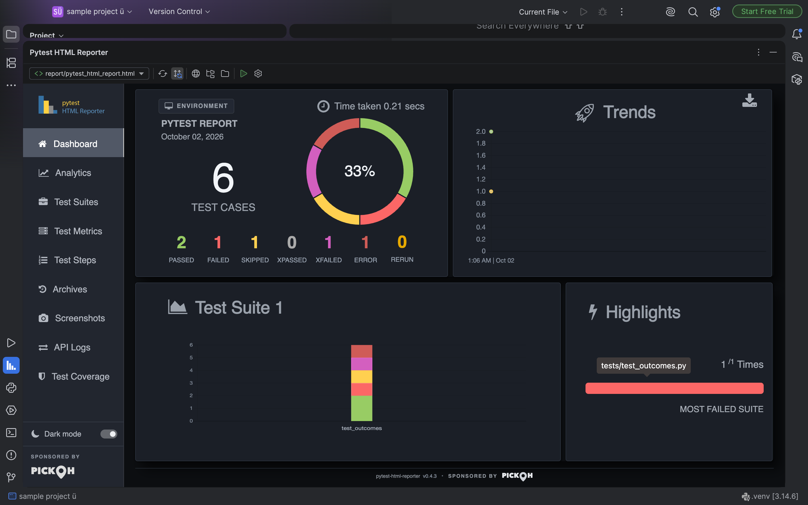

# pytest-html-reporter for JetBrains IDEs

A PyCharm / IntelliJ IDEA plugin for [pytest-html-reporter](https://github.com/prashanth-sams/pytest-html-reporter):
generate, find and read your pytest HTML reports without leaving the IDE.

<!-- Plugin description -->
View, find and generate [pytest-html-reporter](https://github.com/prashanth-sams/pytest-html-reporter) reports without leaving PyCharm or IntelliJ IDEA.

**Pytest HTML Reporter tool window**

- Shows the report pytest-html-reporter generated, in the IDE's embedded browser: dashboard, test suites, metrics, charts, filters, screenshots, logs, attachments, steps, analytics, archives and themes all come from the report itself.
- Finds reports in the project automatically and lets you switch between them; remembers your choice per project.
- Reloads when the report file changes, after it is completely written, and stays on the report page you were looking at.
- Opens the report in your system browser, or reveals the file, with one click.

**Run pytest with HTML Report**

- Runs `python -m pytest … --html-report=… --report-open=none` with the project interpreter, shows pytest's output in the Run tool window, and opens the report that run wrote, whether tests passed or failed.
- Uses only the reporter options your installed pytest-html-reporter version supports, and keeps the report location configured in `pytest.ini`, `pyproject.toml`, profiles or `addopts`.
- Offers to install pytest-html-reporter when it is missing from the interpreter.

**Safe by default**

- Reports stay local: no account, no server, no network access needed. Links to websites open in your browser.
- Untrusted projects never run Python, and their reports are not opened automatically.

Report viewing works in any IntelliJ-based IDE; running pytest uses the project interpreter in PyCharm and IntelliJ IDEA with Python support, or an interpreter you choose in Settings | Tools | pytest-html-reporter.
<!-- Plugin description end -->



## Contents

- [Requirements](#requirements)
- [Installation](#installation)
- [Quick start](#quick-start)
- [Using the plugin](#using-the-plugin)
- [Configuration](#configuration)
- [Where the report is written](#where-the-report-is-written)
- [Supported pytest-html-reporter versions](#supported-pytest-html-reporter-versions)
- [Security and privacy](#security-and-privacy)
- [Compatibility](#compatibility)
- [Troubleshooting](#troubleshooting)
- [Development](#development)
- [License and attribution](#license-and-attribution)

## Requirements

- An IntelliJ-based IDE, build 2025.1 (251) or newer. PyCharm is the primary target.
- For running tests: a local Python interpreter with `pytest` and `pytest-html-reporter` 0.3.0 or newer
  (the plugin offers to install the reporter when it is missing).
- For the embedded viewer: an IDE runtime with JCEF (the default JetBrains Runtime). Without it, reports open in the
  system browser.

## Installation

- **From JetBrains Marketplace:** <kbd>Settings</kbd> | <kbd>Plugins</kbd> | <kbd>Marketplace</kbd>, search for
  `pytest-html-reporter`, then <kbd>Install</kbd>.
- **From a ZIP:** download `pytest-html-reporter-<version>.zip` from the
  [releases](https://github.com/prashanth-sams/pytest-html-reporter-jetbrains/releases) (or build it, see
  [Development](#development)), then <kbd>Settings</kbd> | <kbd>Plugins</kbd> | <kbd>⚙</kbd> |
  <kbd>Install Plugin from Disk…</kbd>.

No restart is needed.

## Quick start

1. Open a Python project and make sure it has a Python interpreter (PyCharm: <kbd>Settings</kbd> | <kbd>Project</kbd> |
   <kbd>Python Interpreter</kbd>).
2. Run <kbd>Tools</kbd> | <kbd>pytest-html-reporter</kbd> | <kbd>Run pytest with HTML Report</kbd>, or right-click a
   test file or folder in the Project view and choose **Run pytest with HTML Report**.
3. pytest's output appears in the Run tool window. When it finishes, the report it wrote opens in the
   **Pytest HTML Reporter** tool window and a notification summarises the outcome.

Already generating reports from the terminal or CI? Open the **Pytest HTML Reporter** tool window: reports in the
project are found automatically.

## Using the plugin

### The Pytest HTML Reporter tool window

The tool window shows the selected report exactly as pytest-html-reporter rendered it - every tab, chart, filter,
table export, screenshot, log, attachment, step and archived build. Its toolbar:

| Control | What it does |
| --- | --- |
| Report selector | Every report found in the project, newest first, with its path relative to the project and its modification time. **Open Report…** and **Rescan for Reports** are at the bottom of the list. |
| **Refresh** | Reloads the report from disk and keeps the page you are on (the report's `#test-metrics`-style address). |
| **Toggle Auto-refresh** | Reloads automatically when the report file changes. A reload waits until the file ends with `</html>` and has stopped changing, so a half-written report is never shown. |
| **Open in External Browser** | Opens the report in the system browser (for printing, or for sharing the window). |
| **Reveal Report File** | Shows the file in Finder / Explorer / the file manager. |
| **Open Report…** | Shows any report file you pick. |
| **Run pytest with HTML Report** | See below. |
| Settings | Opens <kbd>Settings</kbd> \| <kbd>Tools</kbd> \| <kbd>pytest-html-reporter</kbd>. |

When nothing can be shown, the tool window says why - no report found yet, the selected file was deleted, the
project is untrusted, or the embedded browser is unavailable - and offers the next step.

The report follows the IDE's light or dark theme until you use the report's own theme switch, which it then
remembers. In a tool window too short for the report's dashboard, the dashboard keeps its layout and scrolls, like
the report's other pages. Exports from the report's tables (CSV, Excel, PDF) are offered for saving through the IDE's
save dialog.

### Run pytest with HTML Report

Available from the tool window, <kbd>Tools</kbd> | <kbd>pytest-html-reporter</kbd>, and the Project view context menu
(where the selected `.py` files and folders become the test targets). It runs:

```text
<python> -m pytest <targets> <arguments> --html-report=<output> --report-open=none
```

- `<python>` is the project interpreter (or the one set in the plugin settings). For a virtual environment or conda
  environment, its `bin` / `Scripts` folder is put first on `PATH` and `VIRTUAL_ENV` / `CONDA_PREFIX` is set, as
  activating it would.
- The command is built as a list of arguments, never through a shell, so spaces and non-ASCII characters in the
  interpreter, project, targets and report paths are passed unchanged.
- `--report-open=none` keeps the reporter from also opening a browser. It is only passed when the installed
  pytest-html-reporter registers that option (0.3.7 and newer).
- Output goes to the Run tool window with **Stop** and **Rerun**. **Stop** interrupts pytest gently first (SIGINT),
  so the reporter still writes a report of the tests that ran; pressing it again ends the process. The **Stop**
  offered by the "already running" notification ends pytest by itself if the interrupt is ignored for 10 seconds
  (as happens when the IDE was started in the background).
- When pytest finishes, the plugin opens the report **that run wrote**: the file at the expected location, modified
  after the run started. This happens after failing runs too. If the run wrote nothing - no tests collected,
  `--collect-only`, a crash - you are told so, and an older report is never presented as the new one.
- Only one run per project at a time; starting another while one is active is refused with an option to stop it.
- Before running, the plugin checks the interpreter (a short read-only script reporting versions and the
  reporter's registered options). If `pytest` or `pytest-html-reporter` is missing, it offers to install them with
  `python -m pip install`, or to copy the command.
- Arguments that would stop a report from being written are pointed out before the run starts (`-p no:reporter`) or
  in the console header (`--collect-only`, `--report-shard` without `--report-shard-merge`,
  `PYTEST_DISABLE_PLUGIN_AUTOLOAD`, and `--html`, which belongs to the separate pytest-html plugin).

### Report discovery

Reports are found by a single bounded background search when the tool window first needs them (and when you choose
**Rescan for Reports** or change the discovery settings). After that, only folders named by IDE file-system events
are re-checked. The search:

- opens only `pytest_html_report.html` files and `.html` files that have pytest-html-reporter's `output.json` beside
  them, and confirms each by the report's own signature in its first bytes;
- skips virtual environments (by their `pyvenv.cfg` / `conda-meta` marker, whatever the folder is called), dependency
  folders (`site-packages`, `node_modules`), caches, VCS data and build output (`build`, `dist`, `out`, `target`);
- does not follow symbolic links, and stops at the configured depth, after 20,000 folders or after 5 seconds.

The output folder from the settings, `report/`, `reports/` and the working directory are always checked directly, and
you can add more locations in the settings.

### Context menu

On a report HTML file in the Project view or an editor tab: **Open in Pytest HTML Reporter**.

### Existing pytest run configurations

Turn on **Refresh the viewer when pytest run configurations finish** in the settings, and after any Python test run
configuration that uses pytest finishes, the newest report written during it is shown. The run configuration itself
is not changed; keep the reporter's options in pytest configuration, for example:

```ini
# pytest.ini
[pytest]
html_report = report
report_open = none
```

## Configuration

<kbd>Settings</kbd> | <kbd>Tools</kbd> | <kbd>pytest-html-reporter</kbd>:

| Setting | Default | Notes |
| --- | --- | --- |
| Interpreter | *(project interpreter)* | A Python executable; needed in IDEs without Python support. Stored per machine (`.idea/workspace.xml`). |
| Working directory | project root | Relative to the project root. |
| Targets | *(pytest's `testpaths`)* | Files, folders or node IDs, separated by spaces. |
| Additional arguments | | Passed to pytest as typed, e.g. `-m "not slow" -k login -n 4`. Quote values with spaces. |
| Environment variables | parent environment included | Added to the run and the interpreter check. |
| Output path | `report` | `--html-report` value: a folder or an `.html` file, relative to the working directory. strftime placeholders (`reports/%Y%m%d`) work with pytest-html-reporter 0.3.4+. Empty: pytest configuration or the reporter's default decides. |
| Keep the report location from pytest configuration | on | See [below](#where-the-report-is-written). |
| Show the report in the IDE after each run | on | |
| Reload the viewer when the report file changes | on | Same as **Toggle Auto-refresh**. |
| Use the IDE's light or dark theme | on | Until a theme is picked in the report itself. |
| Block remote content in the embedded viewer | on | pytest-html-reporter reports are self-contained. |
| Search depth / Skipped folders / Additional locations | 6 / see above / none | Report discovery scope. |
| Refresh the viewer when pytest run configurations finish | off | Opt-in run configuration integration. |

Shared settings are stored in `.idea/pytestHtmlReporter.xml` and can be committed; the interpreter and the selected
report are machine-specific and stay in `.idea/workspace.xml`.

Report contents - title, logs, screenshots, archives, JUnit XML, profiles - are configured where
pytest-html-reporter reads them: the command line, `pytest.ini` / `tox.ini` / `setup.cfg`, `pyproject.toml` and
`PYTEST_HTML_REPORTER_*` variables. The plugin does not duplicate that configuration.

## Where the report is written

pytest-html-reporter writes `pytest_html_report.html`, `output.json`, `pytest_screenshots/` and `archive/` into one
folder. **Without any configuration that folder is the working directory**, i.e. `./pytest_html_report.html` - the
upstream README describes `report/pytest_html_reporter.html`, but the code (0.3.0 - 0.4.3) and every run checked while
building this plugin write `./pytest_html_report.html`.

For **Run pytest with HTML Report**, the location is decided in this order:

1. `--html-report` in your own arguments;
2. with **Keep the report location from pytest configuration** on: a path from `addopts` (or `PYTEST_ADDOPTS`), a
   named profile, a `PYTEST_HTML_REPORTER_*` variable or the `html_report` ini key - found by asking the installed
   reporter itself (`pytest-html-reporter config --json`, 0.4.3+) plus reading `addopts`;
3. otherwise the plugin's **Output path** (`report` by default).

The console header of each run states which one applied and the exact file the plugin expects.

## Supported pytest-html-reporter versions

| Version | Run and view | Notes |
| --- | --- | --- |
| 0.4.3 (latest, verified) | ✓ | Report path resolved through `pytest-html-reporter config --json`, including profiles. |
| 0.3.7 - 0.4.2 | ✓ | `--report-open=none` passed. |
| 0.3.4 - 0.3.6 | ✓ | No `--report-open` option in these releases (they never open a browser). strftime paths supported. |
| 0.3.0 - 0.3.3 (0.3.0 verified) | ✓ | No strftime expansion of paths. In 0.3.0, `attach()` raises `AttributeError`, so screenshots cannot be attached - fixed in later 0.3.x releases. |
| 0.2.x and older | ✗ | Fails on current pytest with an `INTERNALERROR` and writes no report; the plugin offers to upgrade. Existing reports from any version can still be viewed. |

Optional options are passed only when the installed reporter registers them, which the interpreter check reads
from the reporter's own `pytest_addoption`.

## Security and privacy

- **Untrusted projects:** Python is never run (no interpreter check, no pip, no pytest), and reports are not opened
  automatically; you can still open one explicitly or in the system browser.
- **Containment:** the embedded browser loads only the report and files in its folder (`pytest_screenshots/…`),
  plus `data:` and `blob:` resources. Remote content is blocked by default. Links to websites and `mailto:` open in
  the system browser; links to other local files open outside the viewer only when they are inside the report
  folder or the project; everything else is blocked. Pop-up windows are never opened.
- **No bridge:** no JavaScript-to-IDE bridge is installed; nothing in a report can call into the IDE.
- **No network, no account:** the plugin needs neither. The only network access is `pip install`, and only when you
  choose **Install**.

## Compatibility

Verified (see [docs/VERIFICATION.md](docs/VERIFICATION.md) for the exact checks and results):

| IDE | Build | Plugin Verifier | Runtime (macOS) |
| --- | --- | --- | --- |
| PyCharm Community 2025.1.6.2 | 251.29188.66 | Compatible | Sandbox smoke test (also with JCEF disabled), unit and platform tests |
| PyCharm Community 2025.2.6.2 | 252.28539.90 | Compatible | - |
| PyCharm 2025.3.6.1 | 253.33813.50 | Compatible | - |
| PyCharm 2026.1.5 | 261.27258.51 | Compatible | - |
| PyCharm 2026.2.3 | 262.10968.92 | Compatible | Sandbox smoke test |
| IntelliJ IDEA 2026.2.3 with the Python plugin | 262.10968.63 | Compatible | - |
| PyCharm 2026.3 EAP | 263.6259.38 | No plugin problems; one known verifier gap ([details](docs/VERIFICATION.md#4-plugin-verifier)) | - |

On 2026.2+ the verifier also notes one deprecated API in the settings page; its replacement does not exist in 2025.1.

Not tested: Windows and Linux hosts (the CI workflows target Linux but have not run yet; the sandbox smoke test ran
only on macOS), IntelliJ IDEA at runtime, remote interpreters (unsupported for running, see below), conda
environments, and interpreters other than CPython 3.9 and 3.14.

**Remote interpreters** (SSH, Docker, Docker Compose, WSL and other targets) run Python somewhere else, while this
plugin starts pytest on the local machine and reads the report from the local disk, so **Run pytest with HTML
Report** cannot use them and says so. Reports written into the project folder by such runs (for example through a
mapped volume) can still be viewed, and the run-configuration integration picks them up.

**JCEF:** since 2026.2 the embedded browser ships as the bundled plugin `com.intellij.modules.jcef`; this plugin
declares an optional dependency on it. In 2025.1 - 2026.1 JCEF is part of the platform. If the JCEF plugin is
disabled, or the IDE runs on a runtime without JCEF, the tool window offers the system browser instead.

## Troubleshooting

**The tool window says "No pytest-html-reporter report found".** Run **Run pytest with HTML Report**, or check
where your reports are written: the reporter's default is the working directory (`./pytest_html_report.html`). Folders
named `build`, `dist`, `out`, `target`, `htmlcov` and virtual environments are skipped by the search; add the folder
under **Additional locations**, or use **Open Report…**.

**"pytest-html-reporter is not installed".** The interpreter the plugin uses is named in the message. Install the
reporter there (`<python> -m pip install pytest-html-reporter`) or choose another interpreter in the settings. If pip
itself is missing, run `<python> -m ensurepip` or use the IDE's Python Packages tool window.

**The report also opens in my browser.** Your arguments or configuration set `--report-open=always`/`auto`, or the
installed reporter predates 0.3.7 (then it never opens one). With pytest run configurations, set
`report_open = none` in `pytest.ini`.

**"It did not write a new report".** pytest-html-reporter writes no report for a run without results: no tests
collected (exit code 5), `--collect-only`, `-p no:reporter`, a shard leg without `--report-shard-merge`, or an
internal error. The Run tool window has pytest's output.

**The report does not refresh.** Check that **Toggle Auto-refresh** is on. Reports outside the project are watched
too, but some network file systems deliver no change events; use **Refresh**.

**The embedded browser is not available.** The IDE runs on a runtime without JCEF, or the JCEF plugin is disabled
(2026.2+). Use the default JetBrains Runtime (<kbd>Help</kbd> | <kbd>Find Action</kbd> |
<kbd>Choose Boot Java Runtime for the IDE</kbd>) or enable the **Web Browser (JCEF)** plugin. **Open in External
Browser** always works.

**Printing.** The report's print button opens a print window, which the embedded viewer does not; use **Open in
External Browser** and print from there.

**The interpreter is remote.** See [Compatibility](#compatibility).

## Development

Requirements: JDK 21 (provisioned automatically by Gradle when missing), network access for the first build.

```bash
./gradlew buildPlugin                     # build/distributions/pytest-html-reporter-<version>.zip
./gradlew test                            # unit and platform tests
PYTEST_HTML_REPORTER_PYTHON=/path/to/venv/bin/python ./gradlew test   # plus end-to-end runs with a real reporter
PYTEST_HTML_REPORTER_PYTHON_WITHOUT_REPORTER=/path/to/python ./gradlew test  # plus the install offer (pytest, no reporter)
./gradlew :verifyPluginStructure :verifyPluginProjectConfiguration
./gradlew :verifyPlugin                   # Plugin Verifier against the IDEs in gradle.properties (verifyIdes)
./gradlew :verifyPlugin -PverifyIdes=PyCharm:2026.2.3  # one IDE at a time
./gradlew runIde                          # sandbox IDE with the plugin
scripts/smoke-test.sh                     # scripted sandbox smoke test with screenshots (needs a desktop)
scripts/smoke-test.sh runSmokeTest262     # the same in PyCharm 2026.2.3
scripts/generate-fixtures.sh              # regenerate test fixtures from released pytest-html-reporter packages
```

Layout:

```text
src/main/kotlin/io/github/prashanthsams/pytesthtmlreporter/
  core/         platform-independent logic: command building, upstream path rules, discovery, policies (unit tested)
  viewer/       tool window, JCEF browser, viewer controller
  run/          run service, interpreter resolution, probe, environment
  discovery/    report discovery service
  settings/     persistent settings and the settings page
  python/       optional Python integration (loaded only with Python support)
  integration/  opt-in run-configuration listener
  actions/      actions
src/main/resources/
  META-INF/plugin.xml, pytest-html-reporter-python.xml, pytest-html-reporter-jcef.xml, plugin icons
  python/pytest_html_reporter_probe.py   the read-only interpreter check
src/test/          unit tests (core) and platform tests (settings, discovery, JCEF rendering, real runs)
smoke-test/        test-only plugin driving the real plugin in a sandbox IDE (never distributed)
scripts/           fixture generation and smoke test
docs/              publishing guide, Marketplace listing, verification report, screenshots
```

Use the root tasks (`:verifyPlugin`, `:buildPlugin`): the `smoke-test` project is a test-only plugin with publishing
and verification disabled.

**Sandbox IDEs 2026.2+ and JCEF.** Since 2026.2 the JCEF plugin loads Chromium from `plugins/jcef-plugin/jcef`, which
only the OS-specific installers contain - not the multi-OS archives this build compiles and verifies against. A
`runIde` sandbox on 2026.2+ therefore needs `useInstaller = true` (as `runSmokeTest262` does) for the embedded viewer
to work; Chromium's own sandbox is switched off there with `-Dide.browser.jcef.sandbox.enable=false`, because it needs
the signed app bundle of an installed IDE.

See [docs/PUBLISHING.md](docs/PUBLISHING.md) for releases and [docs/VERIFICATION.md](docs/VERIFICATION.md) for what
was verified.

## License and attribution

MIT - see [LICENSE](LICENSE). pytest-html-reporter is © Prashanth Sams, MIT licensed; the plugin uses the copy
installed in your environment and does not bundle it. Third-party notices for test fixtures and build tooling are
in [NOTICE.md](NOTICE.md).
